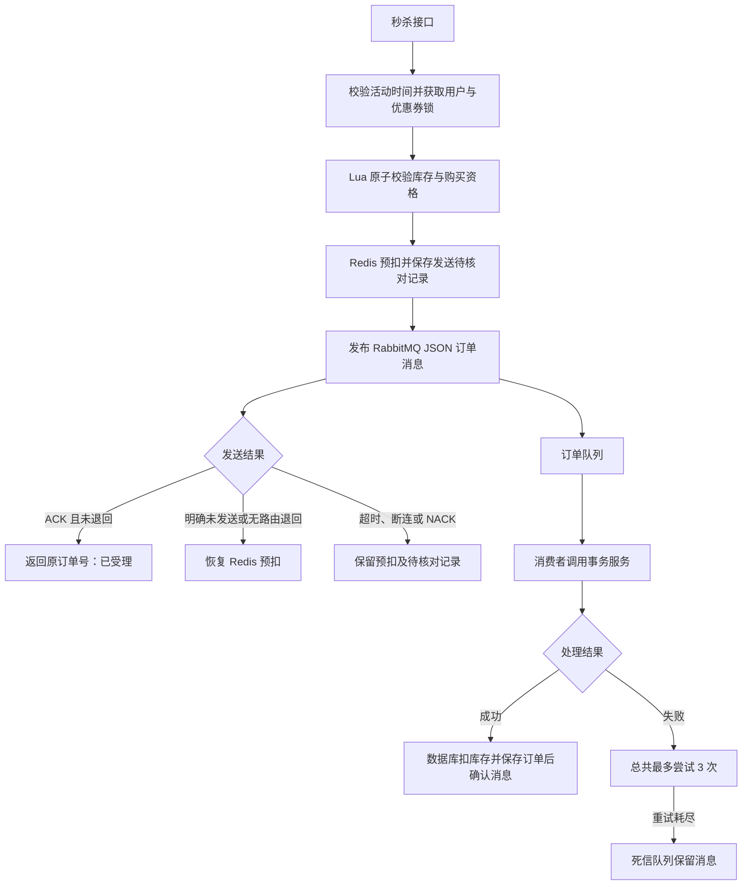

# hm-dianping｜黑马点评

> 本地优惠与探店社区（课程重学与功能扩展）

基于黑马点评课程项目重学实现的 Java 后端练习，围绕商户发现、优惠券抢购和探店内容分发，实践 Redis 缓存、并发控制与 RabbitMQ 异步下单。

当前版本将秒杀提交从进程内阻塞队列切换到 RabbitMQ，补充了发布确认、无路由退回、消费幂等、有限重试及死信保留。项目保留原课程包名 `com.hmdp` 和数据库表结构，便于对照学习。

## 功能与实现

| 模块 | 实现内容 |
| --- | --- |
| 登录与身份 | 手机验证码登录；Redis Hash 保存 Token；双拦截器刷新有效期、校验身份；ThreadLocal 传递和清理用户信息 |
| 商户缓存 | 通用 CacheClient；空值缓存、互斥重建、逻辑过期；商户详情缓存与更新失效 |
| 优惠券秒杀 | Lua 原子校验并预扣库存和购买资格；Redisson 锁；MySQL 条件扣库存和用户/优惠券唯一索引 |
| 异步下单 | RabbitMQ JSON 消息；持久化声明及消息；关联发布确认、mandatory 退回检测；不确定结果保留待核对记录 |
| 消费恢复 | 沿用原订单号幂等落库；独立事务服务；总共最多处理 3 次；耗尽后转入死信队列 |
| 探店与关注 | 笔记发布、详情、点赞、点赞用户列表；Set 关注关系与共同关注；ZSet 粉丝收件箱 |
| 动态分页 | 时间戳和 offset 双游标滚动分页，覆盖同分值跨页及已删除动态的游标推进 |
| 附近商户 | Redis GEO 距离排序与分页；按类型维护索引；商户变更时失效 |
| 用户签到 | Bitmap 按月记录签到，统计当前月份截至当天的连续签到天数 |
| UV 实验 | HyperLogLog 去重与百万数据量学习测试，尚未接入真实访问埋点 |

## 秒杀请求如何执行



接口返回订单号表示消息已受理，数据库订单由消费者稍后创建。发送确认超时并不能证明消息没有到达，因此不会直接回补库存；消费者重投始终使用同一个订单号。

`VoucherOrderAsyncService` 是保留的旧内存队列练习，已移除 `@Service`，不会随应用启动。当前入口使用 `SeckillOrderPublisher`。

### RabbitMQ 拓扑

| 资源 | 名称 / 路由键 |
| --- | --- |
| 业务 Direct 交换机 | `seckill.order.exchange` |
| 业务队列 | `seckill.order.queue` |
| 业务绑定路由键 | `seckill.order` |
| 死信 Direct 交换机 | `seckill.order.dlx` |
| 死信队列 | `seckill.order.dlq` |
| 死信绑定路由键 | `seckill.order.failed` |

Bean 会声明交换机、队列和绑定；业务队列通过 **RabbitMQ policy** 连接死信交换机。启动应用声明队列后，在管理后台为应用使用的虚拟主机创建以下策略：

| 配置项 | 值 |
| --- | --- |
| Name | `seckill-order-dlx-policy` |
| Pattern | `^seckill\.order\.queue$` |
| Apply to | `Queues` |
| Priority | `10` |
| Definition：`dead-letter-exchange` | `seckill.order.dlx`（String） |
| Definition：`dead-letter-routing-key` | `seckill.order.failed`（String） |

消费者使用 Spring `AUTO` 确认，失败总尝试次数为 3，重试间隔约为 1 秒、2 秒；耗尽后拒绝且不重新入队。**必须配置上述死信策略**，否则被拒绝消息不会进入项目死信队列。

## 技术栈与本地验证环境

| 组件 | 当前版本 / 说明 |
| --- | --- |
| Java | 本地使用 JDK 17 验证，Maven 源码目标为 Java 8 |
| Spring Boot | `2.3.12.RELEASE` |
| MyBatis-Plus | `3.4.3` |
| MySQL | 本地 MySQL 8；项目沿用 Connector/J `5.1.47` |
| Redis | 本地验证 `3.2.100`；当前功能不依赖 Redis Stream |
| Redisson | `3.13.6` |
| RabbitMQ | 本地 Docker `rabbitmq:4-management`；AMQP 端口 `5672`，管理端口 `15672` |
| Spring AMQP | 由 Spring Boot 管理，为 `2.2.18.RELEASE` |
| 测试 | JUnit 5、Mockito、独立 Redis 进程、独立 RabbitMQ 测试队列 |

## 本地启动

### 1. 准备环境

安装 JDK、Maven、MySQL，并启动 Redis 和 RabbitMQ。源码只包含后端；完整网页、Nginx 和图片资源需要自行准备。默认应用端口为 `8081`。

```bash
git clone https://github.com/cs-sdran/hm-dianping.git
cd hm-dianping
```

### 2. 初始化数据库

在 MySQL 客户端中，新建一个供本项目使用的空数据库，再导入课程样例数据：

```sql
CREATE DATABASE hmdp CHARACTER SET utf8mb4;
USE hmdp;
SOURCE src/main/resources/db/hmdp.sql;
```

`hmdp.sql` 含 `DROP TABLE`，只用于空库初始化。更新已有数据库时执行增量脚本，不要重新导入全量 SQL：

```sql
USE hmdp;
SOURCE src/main/resources/db/migration/20261016_voucher_order_unique.sql;
SOURCE src/main/resources/db/migration/20261020_follow_unique.sql;
```

脚本会检查重复数据并在异常时停止，不会自动删除重复订单或关注关系。新库也可执行上述增量脚本核对索引。

### 3. 配置连接

将示例复制为本地配置文件（PowerShell）：

```powershell
Copy-Item src/main/resources/application.example.yaml src/main/resources/application.yaml
$env:DB_USERNAME = '你的数据库用户名'
$env:DB_PASSWORD = '你的数据库密码'
$env:RABBITMQ_USERNAME = '你的RabbitMQ用户名'
$env:RABBITMQ_PASSWORD = '你的RabbitMQ密码'
```

示例支持 `DB_URL`、`REDIS_HOST`、`REDIS_PORT`、`REDIS_DATABASE`、`REDIS_PASSWORD`、`RABBITMQ_HOST`、`RABBITMQ_PORT`、`RABBITMQ_VHOST` 和 `SERVER_PORT` 等环境变量。Linux/macOS 可使用对应的 `cp` 和 `export` 命令。RabbitMQ 用户需具有目标虚拟主机的读写及配置权限。

`application.yaml`、`.env`、日志和 `target/` 均不提交到仓库。保留示例中的发布确认、mandatory 和有限重试配置。

### 4. 启动应用

```bash
mvn spring-boot:run
```

或打包后运行：

```bash
mvn -DskipTests package
java -jar target/hm-dianping-0.0.1-SNAPSHOT.jar
```

首次启动后，按上文配置死信策略。图片上传路径目前仍位于 `SystemConstants.IMAGE_UPLOAD_DIR`，请根据本机前端/Nginx 图片目录调整。

验证码当前写入应用日志，仅用于本地登录练习，未对接短信服务。登录成功后，将响应中的 Token 原样放入请求头 `authorization`，不需要添加 `Bearer` 前缀。

新增秒杀券请使用 `POST /voucher/seckill`：数据库事务提交后会初始化 Redis 库存。直接插入数据库的优惠券不会自动获得 Redis 秒杀库存。

## 常用接口

以下路径均相对于 `http://localhost:8081`，省略了通用请求头及业务参数。

| 方法 | 路径 | 用途 |
| --- | --- | --- |
| POST | `/user/code?phone=...` | 发送本地练习验证码 |
| POST | `/user/login` | 手机号与验证码登录 |
| GET | `/user/me` | 当前登录用户 |
| GET | `/shop/{id}` | 商户详情 |
| GET | `/shop/of/type?typeId=...&current=1&x=...&y=...` | 附近商户；x 为经度、y 为纬度 |
| POST | `/voucher/seckill` | 创建秒杀券并在提交后初始化库存 |
| POST | `/voucher-order/seckill/{id}` | 提交秒杀订单 |
| POST | `/blog` | 发布探店笔记 |
| PUT | `/blog/like/{id}` | 点赞或取消点赞 |
| GET | `/blog/likes/{id}` | 点赞用户列表 |
| PUT | `/follow/{id}/{isFollow}` | 关注或取消关注 |
| GET | `/follow/common/{id}` | 共同关注 |
| GET | `/blog/of/follow?lastId=...&offset=0` | 关注动态滚动分页，首次 lastId 可传当前毫秒时间戳 |
| POST | `/user/sign` | 当天签到 |
| GET | `/user/sign/count` | 当前月连续签到天数 |

## 如何运行测试

### 普通回归

```bash
mvn test
```

涉及 Redis 的测试会启动临时 Redis 进程，不使用开发 Redis 数据。需提供本机 `redis-server` 可执行文件；默认支持 PATH，Windows 开发环境还兼容原练习安装路径。可显式指定：

```powershell
mvn '-Dhmdp.test.redis.executable=C:/path/to/redis-server.exe' test
```

普通回归会跳过真实 RabbitMQ 联调及手动练习发送测试，不会向业务订单队列发送固定练习数据。

### RabbitMQ 隔离联调

在本地配置文件正确、RabbitMQ 可连接时执行：

```powershell
mvn '-Dhmdp.rabbitmq.retry-integration-test=true' test
```

联调使用随机命名的独立队列和交换机，结束后清理，不读取业务队列；资格服务、锁、ID 生成及数据库事务使用模拟对象。覆盖消息入队后异步处理、无路由退回后恢复预扣、有限重试及死信转移。

2026-10-29 的全量测试结果：**159 项中 158 项通过，1 项手动发送练习按设计跳过，失败和错误均为 0**。这是本地功能回归结果，不是吞吐量或线上性能指标。

`RabbitMqSendTest` 是会向业务队列发送固定订单的旧手动练习，不用于普通回归。`scripts/` 保留了此前各学习阶段的 HTTP 验收脚本，其中内存队列版秒杀脚本尚未迁移为 RabbitMQ 版，不能直接作为当前版秒杀验收依据。

## 目录

```text
src/main/java/com/hmdp/
  config/       Spring、Redis、RabbitMQ 与时钟配置
  controller/   HTTP 接口
  consumer/     RabbitMQ 订单消费者
  service/impl/ 业务服务、资格服务、发布服务与事务落库
  interceptor/  身份刷新与登录校验
  utils/        缓存、ID、Redis Key 等工具
src/main/resources/
  application.example.yaml  无凭据的配置示例
  db/                       初始化数据与增量 SQL
  mapper/                   MyBatis XML
  *.lua                     资格预扣、回补与解锁脚本
src/test/java/              单元测试与隔离中间件联调
docs/                       各阶段说明和测试记录
scripts/                    历史 HTTP 验收脚本
```

## 当前边界与后续工作

- RabbitMQ 已接入实际秒杀入口；真实 HTTP、Redis 预扣和 MySQL 落库的 RabbitMQ 版完整验收尚未完成。
- `seckill:publish:pending` 保存投递结果不确定的订单；目前需要人工核对，尚无自动对账或补发任务。
- Redis 资格预扣与发送记录写入不是一个原子操作，尚未实现跨 Redis、RabbitMQ、MySQL 的最终一致性恢复闭环。
- 死信队列暂不自动消费；订单状态查询、失败通知与前端轮询仍待补充。
- 签到连续天数限当前月份；HyperLogLog 只作为学习实验。

## 学习记录与验证证据

- [RabbitMQ 秒杀入口接入说明](docs/RabbitMQ秒杀入口接入说明-2026-10-29.md)
- [RabbitMQ 重试与死信联调报告](docs/RabbitMQ重试与死信联调报告-2026-10-29.md)
- [RabbitMQ 接入后的回归结果](docs/rabbitmq-entry-regression-2026-10-29.json)
- [此前实战篇收尾验收记录](docs/实战篇收尾验收报告-2026-10-24.md)
- [附近商户 GEO 功能说明](docs/附近商户GEO功能说明-2026-10-22.md)
- [HyperLogLog UV 学习说明](docs/UV统计学习说明-2026-10-24.md)

历史报告反映对应学习阶段的代码状态，以本 README 和最新 RabbitMQ 接入说明为当前行为基准。
